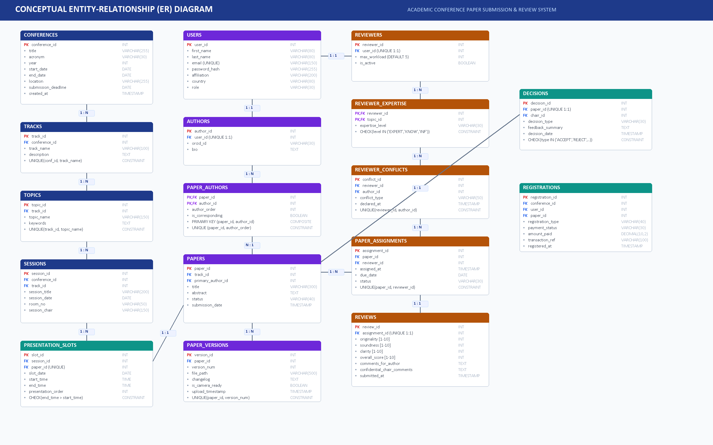

# Academic Conference Paper Submission and Review System DBMS

[](https://www.python.org/)
[](https://flask.palletsprojects.com/)
[](https://www.sqlite.org/)
[](https://www.postgresql.org/)
[](https://getbootstrap.com/)
[]()
[]()

> A robust, full-stack Relational Database Management System (RDBMS) for managing the complete lifecycle of academic conferences—from manuscript submission and double-blind peer review to editorial decisions, registration audits, and conflict-free oral presentation scheduling.

---

## 🏛 Project Overview

Academic conferences require controlled, audit-proof submission workflows, impartial reviewer assignment, conflict-of-interest management, multi-criteria scoring, and collision-free session scheduling. Traditional spreadsheet or email workflows risk lost manuscript versions, biased assignments, and scheduling collisions.

This project delivers an end-to-end relational database solution featuring:
- **17 Normalized Tables** designed up to Third Normal Form (3NF).
- **Multi-Tier Integrity Constraints:** Domain `CHECK` constraints, composite keys, and foreign key cascades.
- **Automated Business Rules:**
  - Real-time **Conflict of Interest (COI)** pre-screening (institutional, co-author, advisory).
  - Mandatory **Review Quota Gating** ($\ge 3$ completed reviews before decisions).
  - **Collision-Free Timetable Generation** preventing presenter double-booking across halls.
- **7 Live Analytical Views & Reports:** Workloads, pending reviews, composite scores, and track statistics.
- **Responsive Web Application:** Role-based portals for Authors, Reviewers, and Program Chairs.
- **Systematic Test Suite:** 5 automated unit/integration tests with a 100% pass rate.

---

## 📐 Conceptual ER Architecture

The system models 17 tables organized into four decoupled modules:



### Module Breakdown
1. **Conference Governance:** `Conferences`, `Tracks`, `Topics`
2. **Submissions & Multi-Versioning:** `Users`, `Authors`, `Papers`, `Paper_Authors`, `Paper_Versions`
3. **Double-Blind Review Engine:** `Reviewers`, `Reviewer_Expertise`, `Reviewer_Conflicts`, `Paper_Assignments`, `Reviews`
4. **Decisions & Timetabling:** `Decisions`, `Registrations`, `Sessions`, `Presentation_Slots`

---

## 🚀 Milestone Deliverables Breakdown

### 📘 Review 1: Conceptual Design & 3NF Normalization
- **14 Principal Entities + Bridge Tables:** Modeled in Crow's Foot ER notation.
- **3NF Normalization:** Zero partial dependencies (2NF) and transitive dependencies (3NF).
- **Documentation:** [`REVIEW_1_DOCUMENTATION.md`](REVIEW_1_DOCUMENTATION.md)
- **Presentation Deck:** [`Academic_Conference_DBMS_Review1.pptx`](Academic_Conference_DBMS_Review1.pptx)

### 📙 Review 2: Physical Schema, Advanced SQL & Analytical Views
- **Physical DDL Execution:** All 17 tables created with constraints in PostgreSQL, MySQL, and SQLite.
- **50+ Rows Dataset:** Simulating the *IEEE ICDSAI 2026* conference with realistic accepts, rejects, and pending reviews.
- **Advanced SQL Queries:** Multi-table 4-way joins, `GROUP BY ... HAVING` aggregate scoring, and correlated `NOT EXISTS` subqueries.
- **The 7 Mandated Views:**
  1. `vw_pending_reviews` - Unsubmitted reviews, reviewers, and deadlines.
  2. `vw_reviewer_workload` - Assigned vs. completed reviews and remaining capacity.
  3. `vw_paper_scores` - Multi-criteria averages (Originality, Soundness, Clarity) and score spreads.
  4. `vw_decisions_summary` - Chair verdicts, avg scores, and feedback rationale.
  5. `vw_accepted_papers` - Camera-ready verification and registration payment audit.
  6. `vw_programme_schedule` - Master timetable (Room, Session, Paper, Presenter).
  7. `vw_track_statistics` - Acceptance rates and submission volume per track.
- **B-Tree Indexes:** Indexes on `track_id`, `status`, `reviewer_id`, and `paper_id`.
- **Documentation:** [`REVIEW_2_DOCUMENTATION.md`](REVIEW_2_DOCUMENTATION.md)
- **Presentation Deck:** [`Academic_Conference_DBMS_Review2.pptx`](Academic_Conference_DBMS_Review2.pptx)
- **Executable SQL:** [`review2_schema_and_queries.sql`](review2_schema_and_queries.sql)

### 📕 Review 3: Full-Stack Web Application & Systematic Testing
- **Python Flask Web Application (`app.py`):**
  - **Author Portal (`/author`):** Submit manuscripts, track revisions ($V_1, V_2$), and upload camera-ready PDFs.
  - **Reviewer Portal (`/reviewer`):** Double-blind review entry (1–10 scoring) with separated author feedback and confidential chair remarks.
  - **Program Chair Portal (`/chair`):** Automated COI-protected reviewer assignment and quota-gated decision logging.
  - **Timetable Scheduler (`/schedule`):** Session allocation with cross-hall presenter clash prevention.
  - **Live Dashboard (`/`):** Real-time analytics directly querying the 7 SQL views.
- **Systematic Test Suite (`test_suite.py`):** Automated verification covering versioning, COI detection, quota gates, scheduling collisions, and domain bounds.
- **Documentation:** [`REVIEW_3_DOCUMENTATION.md`](REVIEW_3_DOCUMENTATION.md)
- **Presentation Deck:** [`Academic_Conference_DBMS_Review3.pptx`](Academic_Conference_DBMS_Review3.pptx)

---

## ⚡ Quick Start & Installation

### Prerequisites
- Python 3.10+
- SQLite 3.35+ (built into Python) or PostgreSQL 14+ / MySQL 8.0+

### 1. Clone the Repository
```bash
git clone https://github.com/your-username/academic-conference-dbms.git
cd academic-conference-dbms
```

### 2. Install Dependencies
```bash
pip install flask
```

### 3. Run Systematic Tests
```bash
python test_suite.py
```
*Expected Output:*
```text
[PASS] Test 1 Passed: Paper submission & multi-version tracking verified.
[PASS] Test 2 Passed: Conflict of Interest (COI) detection verified.
[PASS] Test 3 Passed: Minimum 3-review quota enforcement verified.
[PASS] Test 4 Passed: Zero-collision presentation slot scheduling verified.
[PASS] Test 5 Passed: Domain score CHECK constraints verified.
Ran 5 tests in 0.024s - OK
```

### 4. Launch the Web Application
```bash
python app.py
```
Open your browser and navigate to: **`http://127.0.0.1:5000`**

---

## 📁 Repository Directory Structure

```
├── Academic_Conference_DBMS_Review1.pptx    # Review 1 Presentation (10 Slides with ERD)
├── Academic_Conference_DBMS_Review2.pptx    # Review 2 Presentation (11 Slides with SQL & Views)
├── Academic_Conference_DBMS_Review3.pptx    # Review 3 Presentation (11 Slides with Full-Stack Demo)
├── REVIEW_1_DOCUMENTATION.md                # Review 1 Academic Report (ERD & 3NF Proof)
├── REVIEW_2_DOCUMENTATION.md                # Review 2 Academic Report (Physical DDL & Views)
├── REVIEW_3_DOCUMENTATION.md                # Review 3 Academic Report (Web App & Testing)
├── SPEAKER_NOTES_AND_VIVA_QA.md             # Review 1 Viva Q&A Guide
├── REVIEW_2_SPEAKER_NOTES_AND_VIVA.md       # Review 2 Viva Q&A Guide
├── REVIEW_3_SPEAKER_NOTES_AND_VIVA.md       # Review 3 Viva Q&A Guide
├── app.py                                   # Full-Stack Python Flask Web Application
├── test_suite.py                            # Automated Verification Test Suite (unittest)
├── schema.sql                               # Initial DDL & DML Script
├── review2_schema_and_queries.sql           # Production DDL, DML, Views & Triggers Script
├── test_review2_database.py                 # SQLite Database Builder & Verifier
├── conference_review2.db                    # Pre-populated SQLite Database
├── er_diagram.png                           # High-Resolution Crow's Foot ER Diagram (2800x1750)
├── er_diagram_preview.html                  # Interactive Mermaid ER Diagram Viewer
├── generate_er_diagram.py                   # Pillow-based ER Diagram Generator
├── .gitignore                               # Standard Git Ignore Rules
└── README.md                                # Repository Documentation
```

---

## 🛡 Business Rules & Triggers Demonstrated

### 1. Conflict of Interest (COI) Prevention
```sql
CREATE TRIGGER trg_prevent_coi_assignment
BEFORE INSERT ON Paper_Assignments
FOR EACH ROW
BEGIN
    SELECT RAISE(ABORT, 'Integrity Violation: Reviewer has an active Conflict of Interest.')
    WHERE EXISTS (
        SELECT 1 FROM Paper_Authors pa
        JOIN Reviewer_Conflicts rc ON pa.author_id = rc.author_id
        WHERE pa.paper_id = NEW.paper_id AND rc.reviewer_id = NEW.reviewer_id
    );
END;
```

### 2. Mandatory Review Quota Threshold ($\ge 3$ Reviews)
```sql
CREATE TRIGGER trg_enforce_min_review_quota
BEFORE INSERT ON Decisions
FOR EACH ROW
BEGIN
    SELECT RAISE(ABORT, 'Decision Blocked: Paper must have at least 3 completed peer reviews.')
    WHERE (
        SELECT COUNT(*) FROM Paper_Assignments pa
        JOIN Reviews r ON pa.assignment_id = r.assignment_id
        WHERE pa.paper_id = NEW.paper_id
    ) < 3;
END;
```

### 3. Collision-Free Presentation Scheduling
```sql
CREATE TRIGGER trg_prevent_author_slot_collision
BEFORE INSERT ON Presentation_Slots
FOR EACH ROW
BEGIN
    SELECT RAISE(ABORT, 'Scheduling Collision: Author is already presenting in an overlapping time slot.')
    WHERE EXISTS (
        SELECT 1 FROM Presentation_Slots ps
        JOIN Paper_Authors pa_existing ON ps.paper_id = pa_existing.paper_id
        JOIN Paper_Authors pa_new ON pa_new.author_id = pa_existing.author_id
        WHERE pa_new.paper_id = NEW.paper_id AND ps.slot_date = NEW.slot_date AND ps.paper_id != NEW.paper_id
          AND ((NEW.start_time < ps.end_time) AND (NEW.end_time > ps.start_time))
    );
END;
```

---

## 👨‍💻 Course & Submission Metadata

- **Course:** CS304 - Database Management Systems
- **Evaluation Criteria:**
  - Review 1 (Week 7): Conceptual Design, ER Model, 3NF Normalization
  - Review 2 (Week 10): Physical Schema DDL, Advanced SQL Queries, 7 Views, Indexes
  - Review 3 (Week 14): Front-End Web Application, Systematic Testing & End-to-End Demo
- **License:** MIT License
