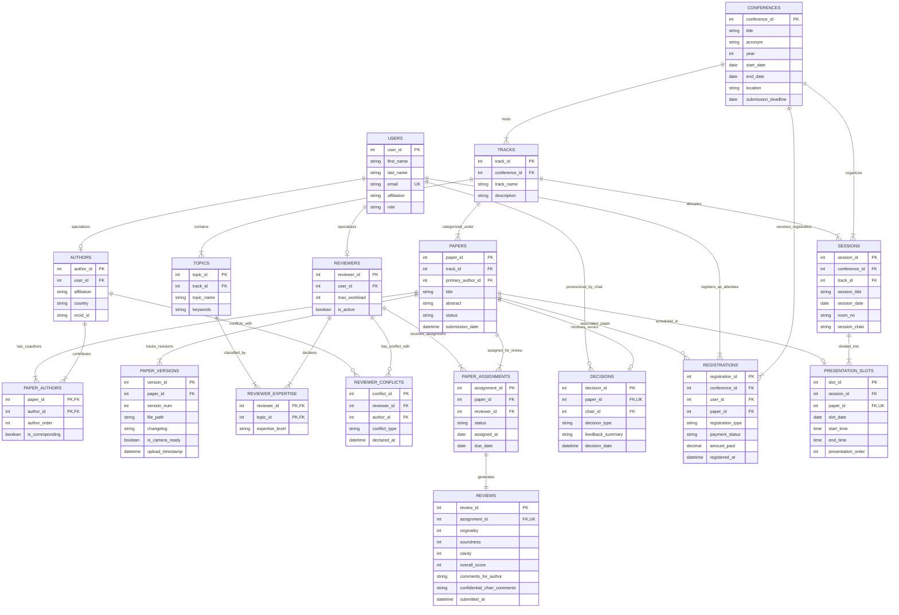

# DATABASE MANAGEMENT SYSTEMS (CS304)
## PROJECT DESIGN AND IMPLEMENTATION DOCUMENT: REVIEW 1 (WEEK 7)

---

# Title: Design and Implementation of a Relational Database Management System for an Academic Conference Paper Submission and Review System

**Course Code / Name:** CS304 - Database Management Systems  
**Evaluation Milestone:** Review 1 (Week 7 - 5 Marks)  
**Date of Submission / Review:** September 2026  
**Document Version:** 1.0 (Final Conceptual & Logical Schema Release)  

---

## Executive Summary

Academic peer-reviewed conferences serve as the primary dissemination vehicle for state-of-the-art scientific research. Managing a modern conference involves handling hundreds of manuscript submissions, coordinating multi-stage double-blind peer reviews, managing reviewer workloads and expertise profiles, detecting and preventing conflicts of interest, recording program committee decisions, tracking attendee/author registrations, and scheduling non-overlapping oral presentation sessions across conference halls.

Historically, conference organizers relied on manual email-based workflows and ad-hoc spreadsheets. These unmanaged workflows lead to critical failures: lost manuscript versions, reviewer conflict-of-interest breaches, unbalanced review workloads, opaque decision tracking, and presentation timetable collisions.

This project designs and implements a robust, normalized (up to Third Normal Form - 3NF) Relational Database Management System (RDBMS) using MySQL / PostgreSQL. This document presents the comprehensive deliverables for **Review 1**:
1. **Problem Identification, Scope, Objectives, Stakeholders, and Functional/Non-Functional Requirements**.
2. **Conceptual Database Design & Crow's Foot Entity-Relationship (ER) Diagram** covering all 14 principal entities specified in the university requirements.
3. **Initial Relational Schema** with primary keys, foreign keys, domain `CHECK` constraints, `UNIQUE` constraints, cascade policies, and formal normalization proofs (1NF, 2NF, 3NF).

---

## Deliverable 1: Problem Identification, Scope, Objectives & Requirements

### 1.1 Problem Identification & Literature / Workflow Breakdown

In academic conference administration, relying on manual email submissions and spreadsheet tracking creates systemic risks across five core areas:

```
┌─────────────────────────────────────────────────────────────────────────────┐
│                 CRITICAL FAILURES IN MANUAL EMAIL WORKFLOWS                 │
├─────────────────────────────────────────────────────────────────────────────┤
│ 1. Manuscript Version Chaos:                                                │
│    • Authors submit revised PDFs via email threads.                         │
│    • Reviewers mistakenly evaluate obsolete drafts instead of revisions.    │
│    • Chairs cannot identify the verified camera-ready copy for publication. │
├─────────────────────────────────────────────────────────────────────────────┤
│ 2. Unchecked Conflict of Interest (COI) Breaches:                           │
│    • Reviewers assigned to papers authored by current co-authors or advisors│
│    • Results in biased evaluations, inflated ratings, or malicious rejections│
│    • Blatant violation of double-blind peer review ethics.                   │
├─────────────────────────────────────────────────────────────────────────────┤
│ 3. Workload Imbalance & Reviewer Starvation:                                │
│    • Popular reviewers overwhelmed (10+ papers) while others receive none.  │
│    • No automated deadline tracking; papers delayed due to missing reviews. │
│    • Submissions evaluated by fewer than 3 reviewers, skewing decisions.   │
├─────────────────────────────────────────────────────────────────────────────┤
│ 4. Fragmented Scoring & Opaque Decision Auditability:                       │
│    • Inconsistent qualitative review rubrics without standardized metrics.  │
│    • Confidential chair remarks accidentally exposed to authors.            │
│    • Inability to query statistical aggregates (avg score, std dev).        │
├─────────────────────────────────────────────────────────────────────────────┤
│ 5. Session Scheduling Collisions & Unregistered Presentations:              │
│    • Authors with multiple accepted papers scheduled at the same time slot. │
│    • Rooms double-booked for concurrent presentation tracks.                │
│    • Unregistered papers scheduled, resulting in empty podiums.             │
└─────────────────────────────────────────────────────────────────────────────┘
```

### 1.2 Project Scope & System Boundaries

#### In-Scope Modules (Review 1 through Review 3):
1. **Conference & Track Governance:** Management of conference metadata, multi-track partitioning (e.g., AI/ML, Networks, Cybersecurity), and topic taxonomies.
2. **Author Submission & Multi-Version Tracking:** Multi-author association, author ordering, corresponding author designation, abstract tracking, and immutable multi-version file archival (Initial Draft, Revised, Final Camera-Ready).
3. **Reviewer Profiling & Topic Expertise:** Explicit mapping of reviewer competence levels (`EXPERT`, `KNOWLEDGEABLE`, `INFORMED`) against track topics.
4. **Conflict of Interest (COI) Management:** Systemic registration of co-author, institutional, and advisory conflicts to enforce automated assignment blocks.
5. **Constrained Reviewer Assignment Engine:** Automated and manual paper-reviewer assignment enforcing capacity limits (max workload) and the required review threshold ($\ge 3$ reviews per paper).
6. **Multi-Criteria Peer Review Evaluation:** Granular numerical scoring (Originality, Technical Soundness, Clarity, Overall Recommendation) and partitioned feedback (Author Constructive Feedback vs. Confidential Program Chair Remarks).
7. **Editorial Decision Workflow:** Program Chair recording of formal verdicts (`ACCEPT`, `REJECT`, `MAJOR_REVISION`, `MINOR_REVISION`) with decision timestamps.
8. **Conference Registration:** Verification of author and attendee conference registration and payment status.
9. **Conflict-Free Presentation Timetabling:** Dynamic allocation of accepted, registered papers to conference sessions, physical halls, and non-overlapping time slots.
10. **Analytical Reporting & Views:** SQL views and aggregate queries for reviewer workload distribution, track acceptance rates, score summaries, and the conference master program.

#### Out-of-Scope (Review 1 System Delimitations):
- **Live Banking Payment Gateway:** Simulated via payment transaction reference IDs, timestamps, and status codes (`PAID`, `PENDING`, `WAIVED`).
- **Full-Text Natural Language Plagiarism Detection:** Managed externally (Turnitin/iThenticate); our schema maintains numerical similarity index percentages.
- **Live Video Streaming / WebRTC Conferencing:** The database tracks physical room identifiers and virtual meeting links without hosting media servers.

---

### 1.3 SMART Project Objectives

- **Specific:** Design and implement a normalized relational database schema comprising 16 tables covering the 14 principal entities defined in the curriculum.
- **Measurable:** Achieve 100% adherence to Third Normal Form (3NF), eliminate all partial and transitive functional dependencies, and enforce 100% automated conflict-of-interest assignment blocks.
- **Achievable:** Implement standard SQL DDL with declarative constraints (`PRIMARY KEY`, `FOREIGN KEY`, `UNIQUE`, `NOT NULL`, `CHECK`) alongside procedural validation triggers for complex cross-table constraints.
- **Relevant:** Directly solves real-world academic peer-review management bottlenecks experienced by international scientific conferences (IEEE, ACM, Springer).
- **Time-bound:** Execute Review 1 (Week 7: Conceptual & Logical Design), Review 2 (Week 10: DDL, Population, Complex Queries & Views), and Review 3 (Week 14: Front-End UI, ACID Transactions, and End-to-End System Testing).

---

### 1.4 User Roles & Access Control Matrix (RBAC)

The system defines six distinct user roles:

| Role Identifier | Description & Primary Responsibilities | Data Access & Operational Permissions | System Constraints & Safeguards |
| :--- | :--- | :--- | :--- |
| **Program Chair (PC)** | Overall conference director and chief academic authority. | Full CRUD on conferences, tracks, reviewer assignments, final decisions, and session timetables. | Cannot alter raw reviewer scores; decisions must cite evaluation basis. |
| **Track Chair (TC)** | Supervises domain-specific tracks (e.g., Computer Vision, Distributed Systems). | Assigns reviewers within their track; monitors pending reviews; drafts acceptance recommendations. | Strictly isolated to papers and reviewers affiliated with their assigned `track_id`. |
| **Author** | Academic researcher submitting manuscripts. | Submits papers; uploads revised/camera-ready versions; registers for conference; views final decisions. | Strictly blocked from viewing reviewer identities (Double-Blind); cannot alter papers past deadlines. |
| **Reviewer** | Subject-matter expert evaluating manuscripts. | Declares topic expertise and conflicts; downloads blinded papers; submits multi-criteria scores and feedback. | Cannot review papers where COI exists; cannot view scores of fellow reviewers until submission. |
| **Attendee / Presenter** | Conference delegate attending presentation sessions. | Views published proceedings, accesses timetable, registers and verifies attendance. | Read-only access to published program; cannot access submission/review records. |
| **System Administrator** | IT infrastructure and database maintainer. | Manages database backups, B-Tree indexes, user account credentials, and transaction audit logs. | Barred from tampering with editorial decisions or peer-review scoring records. |

---

### 1.5 Functional Requirements (FR)

- **FR1: Paper Submission & Multi-Version Lifecycle Management**
  - The system must capture paper metadata: system-generated unique `paper_id`, title, abstract, track affiliation, primary author, and submission timestamp.
  - The system must support multi-author papers with defined author sequence (`author_order`) and corresponding author flags.
  - The system must support multi-version tracking (`Paper_Versions`), maintaining discrete PDF file paths, version numbers ($V_1, V_2, \dots$), upload timestamps, changelogs, and a camera-ready boolean flag.
  - The system must store blinded manuscripts (author metadata stripped) for peer review.

- **FR2: Reviewer Expertise & Conflict of Interest (COI) Profiling**
  - Reviewers must be capable of classifying their competence across track topics into three discrete tiers: `EXPERT`, `KNOWLEDGEABLE`, or `INFORMED`.
  - The system must provide explicit conflict-of-interest declarations (`Reviewer_Conflicts`) categorizing relationships: `CO_AUTHOR`, `SAME_INSTITUTION`, `ADVISORY`, or `PERSONAL`.

- **FR3: Constrained Reviewer Assignment Engine**
  - The system must enforce a configurable maximum workload limit per reviewer (`max_workload`, default = 5).
  - The system must prohibit assigning any reviewer to a paper if a conflict exists between the reviewer and *any* co-author of that paper.
  - The system must enforce a required review threshold of at least 3 assigned reviewers per paper before entering the decision phase.

- **FR4: Multi-Criteria Scoring & Feedback Partitioning**
  - Reviewers must submit numerical evaluations on a 1-to-10 integer scale for:
    1. Originality & Novelty ($1-10$)
    2. Technical Soundness & Methodology ($1-10$)
    3. Clarity & Presentation Quality ($1-10$)
    4. Overall Recommendation Score ($1-10$)
  - The system must strictly partition feedback into:
    - `comments_for_author`: Constructive comments visible to authors after decisions are finalized.
    - `confidential_chair_comments`: Confidential notes visible strictly to Track and Program Chairs.

- **FR5: Program Committee Decision Workflow**
  - The Program Chair must record formal verdicts: `ACCEPT`, `REJECT`, `MAJOR_REVISION`, or `MINOR_REVISION`.
  - Recording an `ACCEPT` verdict enables the camera-ready upload stage and author registration workflow.

- **FR6: Author Registration & Presentation Scheduling**
  - The system must record author/attendee registrations, tracking registration tier (`STUDENT`, `REGULAR`, `AUTHOR`), payment status (`PAID`, `PENDING`), and transaction references.
  - Only papers with `ACCEPT` decisions and at least one registered, paid author may be scheduled for oral presentation.
  - The system must allocate presentations to thematic `Sessions`, specifying physical `room_no`, `slot_date`, `start_time`, and `end_time`.
  - The system must prevent scheduling collisions: no room may host simultaneous papers, and no author may be scheduled in overlapping time slots across different rooms.

- **FR7: Analytical Reporting & Performance Queries**
  - The system must provide instant reporting for:
    - Reviewer workload distribution and pending review monitoring.
    - Track-wise paper submission, rejection, and acceptance rates.
    - Composite paper ranking and score distribution (Average, Min, Max, Standard Deviation).
    - The master conference presentation timetable.

---

### 1.6 Non-Functional Requirements (NFR)

1. **Data Integrity & ACID Compliance:** Enforce referential integrity through foreign key cascades (`ON DELETE CASCADE` for dependent weak entities like versions and assignments; `ON DELETE RESTRICT` for audited decisions). Transactions must guarantee atomicity during multi-assignment dispatches.
2. **Double-Blind Anonymity & Security:** Database views must hide author identities from reviewers during evaluation, and hide reviewer identities from authors in perpetuity.
3. **High Performance & Indexing:** Target query response under $50\text{ ms}$ for typical queries through B-Tree indexing on frequently filtered foreign keys (`track_id`, `paper_id`, `reviewer_id`, `status`).
4. **Scalability:** The relational architecture must efficiently scale to over 2,000 papers, 6,000 reviews, and 100 concurrent sessions without performance degradation.
5. **Auditing & Traceability:** All operational tables must maintain audit timestamps (`created_at`, `updated_at`).

---

## Deliverable 2: Conceptual Design & Entity-Relationship (ER) Modeling

### 2.1 The 14 Principal Entities Dictionary

The table below catalogs the 14 principal entities specified in the university requirements, supplemented by core architectural entities (`Users`, `Paper_Authors`, `Sessions`):

| # | Entity Name | Primary Key | Composite / Foreign Keys | Core Attributes | Lifecycle & Operational Duty |
| :-: | :--- | :--- | :--- | :--- | :--- |
| **1** | `Conferences` | `conference_id` | None | `title`, `acronym`, `year`, `start_date`, `end_date`, `location`, `submission_deadline` | Top-level parent entity encapsulating event metadata and scheduling milestones. |
| **2** | `Tracks` | `track_id` | `conference_id` (FK) | `track_name`, `description` | Subdivides conference into scientific disciplines (e.g., AI/ML, Networks). |
| **3** | `Topics` | `topic_id` | `track_id` (FK) | `topic_name`, `keywords` | Granular research keywords used for expertise matching and paper classification. |
| **4** | `Authors` | `author_id` | `user_id` (FK) | `affiliation`, `country`, `orcid_id`, `bio` | Researcher profile submitting manuscripts; inherits baseline profile from `Users`. |
| **5** | `Papers` | `paper_id` | `track_id` (FK), `primary_author_id` (FK) | `title`, `abstract`, `submission_date`, `status` | Master submission entity tracking editorial status from submission to presentation. |
| **6** | `Versions` (`Paper_Versions`) | `version_id` | `paper_id` (FK) | `version_num`, `file_path`, `upload_timestamp`, `changelog`, `is_camera_ready` | Tracks document revisions, preserving initial blind draft, revised, and camera-ready copies. |
| **7** | `Reviewers` | `reviewer_id` | `user_id` (FK) | `max_workload`, `is_active`, `invitation_accepted` | Academic evaluator profile maintaining workload capacity limits. |
| **8** | `Expertise` (`Reviewer_Expertise`)| `(reviewer_id, topic_id)` | `reviewer_id` (FK), `topic_id` (FK) | `expertise_level` (`EXPERT`, `KNOWLEDGEABLE`, `INFORMED`) | Associative entity mapping reviewer competencies to specific track topics. |
| **9** | `Conflicts` (`Reviewer_Conflicts`)| `conflict_id` | `reviewer_id` (FK), `author_id` (FK) | `conflict_type`, `declared_at` | Formal declaration of COI (co-authorship, same institution, advisory relationship). |
| **10**| `Assignments` (`Paper_Assignments`)| `assignment_id` | `paper_id` (FK), `reviewer_id` (FK) | `assigned_at`, `due_date`, `status` | Dispatch of a specific paper to an eligible, non-conflicted reviewer. |
| **11**| `Reviews` | `review_id` | `assignment_id` (FK, UNIQUE) | `originality`, `soundness`, `clarity`, `overall_score`, `comments_for_author`, `chair_notes` | Formal evaluation scores ($1-10$) and partitioned qualitative feedback. |
| **12**| `Decisions` | `decision_id` | `paper_id` (FK, UNIQUE), `chair_id` (FK) | `decision_type`, `decision_date`, `feedback_summary` | Program Chair's final recorded verdict (`ACCEPT`, `REJECT`, `REVISE`). |
| **13**| `Registrations` | `registration_id` | `conference_id` (FK), `user_id` (FK), `paper_id` (FK) | `registration_type`, `payment_status`, `amount_paid`, `registered_at` | Tracks delegate conference registration, paper fee clearance, and attendance. |
| **14**| `Presentation_Slots` | `slot_id` | `session_id` (FK), `paper_id` (FK, UNIQUE) | `slot_date`, `start_time`, `end_time`, `room_no`, `presentation_order` | Time and room allocation for presenting accepted papers in the conference program. |
| *15*| `Users` *(Supporting)* | `user_id` | None | `first_name`, `last_name`, `email` (UNIQUE), `password_hash`, `organization` | Base authentication and demographic profile entity uniting all user roles. |
| *16*| `Paper_Authors` *(Supporting)* | `(paper_id, author_id)` | `paper_id` (FK), `author_id` (FK) | `author_order`, `is_corresponding` | Resolves the Many-to-Many ($M:N$) relationship between Papers and Co-Authors. |
| *17*| `Sessions` *(Supporting)* | `session_id` | `conference_id` (FK), `track_id` (FK) | `session_title`, `session_date`, `room_no`, `session_chair` | Thematic grouping of presentation slots within a track and conference room. |

---

### 2.2 Entity Relationships & Cardinality Specifications

```
  1 : 1  ───  One-to-One
  1 : N  ───  One-to-Many
  M : N  ───  Many-to-Many (Resolved via Associative Bridge Tables)
```

| Parent Entity | Child Entity | Cardinality | Associative Bridge / Foreign Key | Operational Business Rule Enforced |
| :--- | :--- | :---: | :--- | :--- |
| `Conferences` | `Tracks` | $1 : N$ | `Tracks.conference_id` | A conference divides into one or more thematic tracks. |
| `Tracks` | `Topics` | $1 : N$ | `Topics.track_id` | A track encompasses multiple distinct research topics. |
| `Users` | `Authors` | $1 : 1$ | `Authors.user_id` (UNIQUE) | An author is a specialized role inheriting base user identity. |
| `Users` | `Reviewers` | $1 : 1$ | `Reviewers.user_id` (UNIQUE) | A reviewer is a specialized role inheriting base user identity. |
| `Authors` | `Papers` | $M : N$ | `Paper_Authors(paper_id, author_id)` | An author can co-author multiple papers; a paper can have multiple co-authors. |
| `Papers` | `Paper_Versions` | $1 : N$ | `Paper_Versions.paper_id` | A paper contains 1 or more sequentially numbered document revisions. |
| `Reviewers` | `Topics` | $M : N$ | `Reviewer_Expertise(reviewer_id, topic_id)` | Reviewers declare competence levels across multiple topics. |
| `Reviewers` | `Authors` | $M : N$ | `Reviewer_Conflicts(reviewer_id, author_id)` | Formal barrier preventing reviewer from evaluating co-author's research. |
| `Papers` | `Reviewers` | $M : N$ | `Paper_Assignments(paper_id, reviewer_id)` | Reviewers evaluate multiple papers; papers evaluated by multiple reviewers. |
| `Paper_Assignments` | `Reviews` | $1 : 1$ | `Reviews.assignment_id` (UNIQUE) | Each completed assignment yields exactly one formal evaluation record. |
| `Papers` | `Decisions` | $1 : 1$ | `Decisions.paper_id` (UNIQUE) | A paper receives exactly one authoritative program committee verdict. |
| `Papers` | `Registrations` | $1 : N$ | `Registrations.paper_id` | Multiple co-authors/attendees can register under a single paper. |
| `Sessions` | `Presentation_Slots` | $1 : N$ | `Presentation_Slots.session_id` | A session organizes multiple sequential presentation slots in one hall. |
| `Papers` | `Presentation_Slots`| $1 : 1$ | `Presentation_Slots.paper_id` (UNIQUE) | An accepted paper is scheduled in at most one presentation slot. |

---

### 2.3 Comprehensive Conceptual ER Diagram (Crow's Foot Notation)



---

## Deliverable 3: Initial Relational Schema & Normalization Analysis

### 3.1 Relational Schema Specifications (Tables, PKs, FKs & Constraints)

The database schema is structured into four cohesive operational modules:

#### Module 1: Conference & User Foundation

1. **`Conferences`**
   - `conference_id` INT AUTO_INCREMENT **PRIMARY KEY**
   - `title` VARCHAR(255) NOT NULL
   - `acronym` VARCHAR(30) NOT NULL
   - `year` INT NOT NULL
   - `start_date` DATE NOT NULL
   - `end_date` DATE NOT NULL
   - `location` VARCHAR(255) NOT NULL
   - `submission_deadline` DATE NOT NULL
   - **Constraints:**
     - `UNIQUE (acronym, year)`
     - `CHECK (end_date >= start_date)`
     - `CHECK (submission_deadline <= start_date)`

2. **`Tracks`**
   - `track_id` INT AUTO_INCREMENT **PRIMARY KEY**
   - `conference_id` INT NOT NULL **FOREIGN KEY** $\rightarrow$ `Conferences(conference_id)` ON DELETE CASCADE
   - `track_name` VARCHAR(100) NOT NULL
   - `description` TEXT
   - **Constraints:**
     - `UNIQUE (conference_id, track_name)`

3. **`Topics`**
   - `topic_id` INT AUTO_INCREMENT **PRIMARY KEY**
   - `track_id` INT NOT NULL **FOREIGN KEY** $\rightarrow$ `Tracks(track_id)` ON DELETE CASCADE
   - `topic_name` VARCHAR(150) NOT NULL
   - `keywords` TEXT
   - **Constraints:**
     - `UNIQUE (track_id, topic_name)`

4. **`Users`**
   - `user_id` INT AUTO_INCREMENT **PRIMARY KEY**
   - `first_name` VARCHAR(80) NOT NULL
   - `last_name` VARCHAR(80) NOT NULL
   - `email` VARCHAR(150) NOT NULL
   - `password_hash` VARCHAR(255) NOT NULL
   - `affiliation` VARCHAR(200) NOT NULL
   - `country` VARCHAR(80) NOT NULL
   - `role` VARCHAR(30) NOT NULL DEFAULT 'AUTHOR'
   - `created_at` TIMESTAMP DEFAULT CURRENT_TIMESTAMP
   - **Constraints:**
     - `UNIQUE (email)`
     - `CHECK (role IN ('CHAIR', 'TRACK_CHAIR', 'AUTHOR', 'REVIEWER', 'ATTENDEE', 'ADMIN'))`

5. **`Authors`**
   - `author_id` INT AUTO_INCREMENT **PRIMARY KEY**
   - `user_id` INT NOT NULL **FOREIGN KEY** $\rightarrow$ `Users(user_id)` ON DELETE CASCADE
   - `orcid_id` VARCHAR(30)
   - `bio` TEXT
   - **Constraints:**
     - `UNIQUE (user_id)`

---

#### Module 2: Submission & Versioning

6. **`Papers`**
   - `paper_id` INT AUTO_INCREMENT **PRIMARY KEY**
   - `track_id` INT NOT NULL **FOREIGN KEY** $\rightarrow$ `Tracks(track_id)` ON DELETE RESTRICT
   - `primary_author_id` INT NOT NULL **FOREIGN KEY** $\rightarrow$ `Authors(author_id)` ON DELETE RESTRICT
   - `title` VARCHAR(300) NOT NULL
   - `abstract` TEXT NOT NULL
   - `status` VARCHAR(40) NOT NULL DEFAULT 'SUBMITTED'
   - `submission_date` TIMESTAMP DEFAULT CURRENT_TIMESTAMP
   - **Constraints:**
     - `CHECK (status IN ('SUBMITTED', 'UNDER_REVIEW', 'REVISION_REQUESTED', 'ACCEPTED', 'REJECTED', 'WITHDRAWN'))`

7. **`Paper_Authors`** (Associative Bridge Entity)
   - `paper_id` INT NOT NULL **FOREIGN KEY** $\rightarrow$ `Papers(paper_id)` ON DELETE CASCADE
   - `author_id` INT NOT NULL **FOREIGN KEY** $\rightarrow$ `Authors(author_id)` ON DELETE RESTRICT
   - `author_order` INT NOT NULL
   - `is_corresponding` BOOLEAN NOT NULL DEFAULT FALSE
   - **Constraints:**
     - **PRIMARY KEY** `(paper_id, author_id)`
     - `CHECK (author_order >= 1)`
     - `UNIQUE (paper_id, author_order)` (No two authors can hold the same position in author sequence)

8. **`Paper_Versions`**
   - `version_id` INT AUTO_INCREMENT **PRIMARY KEY**
   - `paper_id` INT NOT NULL **FOREIGN KEY** $\rightarrow$ `Papers(paper_id)` ON DELETE CASCADE
   - `version_num` INT NOT NULL
   - `file_path` VARCHAR(500) NOT NULL
   - `upload_timestamp` TIMESTAMP DEFAULT CURRENT_TIMESTAMP
   - `changelog` TEXT
   - `is_camera_ready` BOOLEAN NOT NULL DEFAULT FALSE
   - **Constraints:**
     - `UNIQUE (paper_id, version_num)`
     - `CHECK (version_num >= 1)`

---

#### Module 3: Reviewer Expertise, Conflicts & Assignments

9. **`Reviewers`**
   - `reviewer_id` INT AUTO_INCREMENT **PRIMARY KEY**
   - `user_id` INT NOT NULL **FOREIGN KEY** $\rightarrow$ `Users(user_id)` ON DELETE CASCADE
   - `max_workload` INT NOT NULL DEFAULT 5
   - `is_active` BOOLEAN NOT NULL DEFAULT TRUE
   - **Constraints:**
     - `UNIQUE (user_id)`
     - `CHECK (max_workload > 0)`

10. **`Reviewer_Expertise`** (Associative Bridge Entity)
    - `reviewer_id` INT NOT NULL **FOREIGN KEY** $\rightarrow$ `Reviewers(reviewer_id)` ON DELETE CASCADE
    - `topic_id` INT NOT NULL **FOREIGN KEY** $\rightarrow$ `Topics(topic_id)` ON DELETE CASCADE
    - `expertise_level` VARCHAR(30) NOT NULL DEFAULT 'KNOWLEDGEABLE'
    - **Constraints:**
      - **PRIMARY KEY** `(reviewer_id, topic_id)`
      - `CHECK (expertise_level IN ('EXPERT', 'KNOWLEDGEABLE', 'INFORMED'))`

11. **`Reviewer_Conflicts`**
    - `conflict_id` INT AUTO_INCREMENT **PRIMARY KEY**
    - `reviewer_id` INT NOT NULL **FOREIGN KEY** $\rightarrow$ `Reviewers(reviewer_id)` ON DELETE CASCADE
    - `author_id` INT NOT NULL **FOREIGN KEY** $\rightarrow$ `Authors(author_id)` ON DELETE CASCADE
    - `conflict_type` VARCHAR(50) NOT NULL
    - `declared_at` TIMESTAMP DEFAULT CURRENT_TIMESTAMP
    - **Constraints:**
      - `UNIQUE (reviewer_id, author_id)`
      - `CHECK (conflict_type IN ('CO_AUTHOR', 'SAME_INSTITUTION', 'ADVISORY', 'PERSONAL_RELATION', 'OTHER'))`

12. **`Paper_Assignments`**
    - `assignment_id` INT AUTO_INCREMENT **PRIMARY KEY**
    - `paper_id` INT NOT NULL **FOREIGN KEY** $\rightarrow$ `Papers(paper_id)` ON DELETE CASCADE
    - `reviewer_id` INT NOT NULL **FOREIGN KEY** $\rightarrow$ `Reviewers(reviewer_id)` ON DELETE RESTRICT
    - `assigned_at` TIMESTAMP DEFAULT CURRENT_TIMESTAMP
    - `due_date` DATE NOT NULL
    - `status` VARCHAR(30) NOT NULL DEFAULT 'ASSIGNED'
    - **Constraints:**
      - `UNIQUE (paper_id, reviewer_id)` (A reviewer cannot receive the same paper multiple times)
      - `CHECK (status IN ('ASSIGNED', 'ACCEPTED', 'DECLINED', 'COMPLETED'))`

13. **`Reviews`**
    - `review_id` INT AUTO_INCREMENT **PRIMARY KEY**
    - `assignment_id` INT NOT NULL **FOREIGN KEY** $\rightarrow$ `Paper_Assignments(assignment_id)` ON DELETE RESTRICT
    - `originality` INT NOT NULL
    - `soundness` INT NOT NULL
    - `clarity` INT NOT NULL
    - `overall_score` INT NOT NULL
    - `comments_for_author` TEXT NOT NULL
    - `confidential_chair_comments` TEXT
    - `submitted_at` TIMESTAMP DEFAULT CURRENT_TIMESTAMP
    - **Constraints:**
      - `UNIQUE (assignment_id)` (Enforces 1:1 relationship between completed assignment and review)
      - `CHECK (originality BETWEEN 1 AND 10)`
      - `CHECK (soundness BETWEEN 1 AND 10)`
      - `CHECK (clarity BETWEEN 1 AND 10)`
      - `CHECK (overall_score BETWEEN 1 AND 10)`

---

#### Module 4: Editorial Decisions, Registration & Scheduling

14. **`Decisions`**
    - `decision_id` INT AUTO_INCREMENT **PRIMARY KEY**
    - `paper_id` INT NOT NULL **FOREIGN KEY** $\rightarrow$ `Papers(paper_id)` ON DELETE RESTRICT
    - `chair_id` INT NOT NULL **FOREIGN KEY** $\rightarrow$ `Users(user_id)` ON DELETE RESTRICT
    - `decision_type` VARCHAR(30) NOT NULL
    - `feedback_summary` TEXT
    - `decision_date` TIMESTAMP DEFAULT CURRENT_TIMESTAMP
    - **Constraints:**
      - `UNIQUE (paper_id)` (Each paper receives exactly one binding decision)
      - `CHECK (decision_type IN ('ACCEPT', 'REJECT', 'MAJOR_REVISION', 'MINOR_REVISION'))`

15. **`Registrations`**
    - `registration_id` INT AUTO_INCREMENT **PRIMARY KEY**
    - `conference_id` INT NOT NULL **FOREIGN KEY** $\rightarrow$ `Conferences(conference_id)` ON DELETE RESTRICT
    - `user_id` INT NOT NULL **FOREIGN KEY** $\rightarrow$ `Users(user_id)` ON DELETE RESTRICT
    - `paper_id` INT **FOREIGN KEY** $\rightarrow$ `Papers(paper_id)` ON DELETE SET NULL
    - `registration_type` VARCHAR(40) NOT NULL
    - `payment_status` VARCHAR(30) NOT NULL DEFAULT 'PENDING'
    - `amount_paid` DECIMAL(10, 2) NOT NULL DEFAULT 0.00
    - `transaction_ref` VARCHAR(100)
    - `registered_at` TIMESTAMP DEFAULT CURRENT_TIMESTAMP
    - **Constraints:**
      - `CHECK (registration_type IN ('STUDENT_AUTHOR', 'REGULAR_AUTHOR', 'ACADEMIC_ATTENDEE', 'INDUSTRY_ATTENDEE'))`
      - `CHECK (payment_status IN ('PAID', 'PENDING', 'WAIVED', 'REFUNDED'))`
      - `CHECK (amount_paid >= 0.00)`

16. **`Sessions`**
    - `session_id` INT AUTO_INCREMENT **PRIMARY KEY**
    - `conference_id` INT NOT NULL **FOREIGN KEY** $\rightarrow$ `Conferences(conference_id)` ON DELETE CASCADE
    - `track_id` INT NOT NULL **FOREIGN KEY** $\rightarrow$ `Tracks(track_id)` ON DELETE RESTRICT
    - `session_title` VARCHAR(200) NOT NULL
    - `session_date` DATE NOT NULL
    - `room_no` VARCHAR(50) NOT NULL
    - `session_chair` VARCHAR(150)
    - **Constraints:**
      - `UNIQUE (conference_id, session_date, room_no, session_title)`

17. **`Presentation_Slots`**
    - `slot_id` INT AUTO_INCREMENT **PRIMARY KEY**
    - `session_id` INT NOT NULL **FOREIGN KEY** $\rightarrow$ `Sessions(session_id)` ON DELETE CASCADE
    - `paper_id` INT NOT NULL **FOREIGN KEY** $\rightarrow$ `Papers(paper_id)` ON DELETE RESTRICT
    - `slot_date` DATE NOT NULL
    - `start_time` TIME NOT NULL
    - `end_time` TIME NOT NULL
    - `presentation_order` INT NOT NULL
    - **Constraints:**
      - `UNIQUE (paper_id)` (Guarantees an accepted paper is scheduled in at most one presentation slot)
      - `CHECK (end_time > start_time)`
      - `UNIQUE (session_id, presentation_order)`

---

### 3.2 Formal Normalization Analysis (1NF $\rightarrow$ 2NF $\rightarrow$ 3NF)

Normalization eliminates operational anomalies (Insertion, Deletion, and Update anomalies) while optimizing data consistency.

#### Step 1: First Normal Form (1NF) Compliance
- **Rule:** A relation is in 1NF if and only if all attribute values are atomic (scalar, indivisible) and there are no repeating groups or arrays.
- **Decomposition Proof:**
  1. *Authors:* In un-normalized systems, co-authors are recorded as a comma-separated string attribute (e.g., `authors: "A. Turing, C. Shannon, J. von Neumann"`). We decomposed this into a dedicated associative table `Paper_Authors`, where each tuple stores exactly one `(paper_id, author_id)`.
  2. *Manuscript Versions:* Storing multiple version file paths in a delimited string violates 1NF. We decomposed this into `Paper_Versions`, where each row represents a single atomic file upload.
  3. *Reviewer Expertise:* Multiple topic competencies are decomposed into atomic rows in `Reviewer_Expertise(reviewer_id, topic_id)`.
- **Verdict:** Schema satisfies **1NF**.

#### Step 2: Second Normal Form (2NF) Compliance
- **Rule:** A relation is in 2NF if it is in 1NF AND every non-prime attribute is fully functionally dependent on the entire primary key (i.e., no partial functional dependencies on composite candidate keys).
- **Decomposition Proof:**
  1. In `Paper_Authors(paper_id, author_id)`: The primary key is composite `(paper_id, author_id)`. The non-key attributes are `author_order` and `is_corresponding`. Both attributes describe the *specific relationship* between this exact author on this exact paper. An author's name or bio does NOT belong in this table; doing so would create a partial dependency $\text{author\_id} \rightarrow \text{author\_bio}$. Instead, bio resides strictly in `Authors` dependent on `author_id`.
  2. In `Reviewer_Expertise(reviewer_id, topic_id)`: The primary key is `(reviewer_id, topic_id)`. The non-key attribute is `expertise_level`. The expertise level depends on *both* the reviewer and the topic. Reviewer workload or topic keywords do not exist here.
- **Verdict:** Schema satisfies **2NF**.

#### Step 3: Third Normal Form (3NF) Compliance
- **Rule:** A relation is in 3NF if it is in 2NF AND there are no transitive functional dependencies (i.e., for every functional dependency $X \rightarrow Y$, either $X$ is a superkey, or $Y$ is a prime attribute). In informal terms: *"Every non-key attribute must depend on the key, the whole key, and nothing but the key."*
- **Decomposition Proof:**
  1. *Transitive Dependency Elimination in `Papers`:* In an un-normalized schema:
     $$\text{paper\_id} \rightarrow \text{track\_id} \rightarrow \text{track\_name}, \text{conference\_id}$$
     This is a transitive dependency ($\text{paper\_id} \rightarrow \text{track\_name}$). We decomposed `Tracks` into a separate relation. `Papers` stores only `track_id`. If a track name changes, it is updated in exactly one row in `Tracks`, preventing update anomalies.
  2. *Transitive Dependency Elimination in `Reviews`:*
     $$\text{review\_id} \rightarrow \text{assignment\_id} \rightarrow \text{paper\_id}, \text{reviewer\_id}$$
     `Reviews` stores only `assignment_id`. Paper title or reviewer email are NOT duplicated in `Reviews`.
  3. *Elimination of User Data Duplication:* `Authors` and `Reviewers` do not duplicate personal contact information (first name, last name, email, password hash). They reference `user_id` in `Users`.
- **Verdict:** Schema satisfies **3NF**.

```
┌─────────────────────────────────────────────────────────────────────────────┐
│                    SUMMARY OF ANOMALY ELIMINATIONS                          │
├─────────────────────────────────────────────────────────────────────────────┤
│ • Insertion Anomaly Resolved:                                               │
│   A new Track or Topic can be registered without requiring any paper to be  │
│   submitted yet.                                                            │
│ • Deletion Anomaly Resolved:                                                │
│   Deleting a paper deletes its versions (via CASCADE) but retains the       │
│   author profiles in `Authors` and `Users`.                                 │
│ • Update Anomaly Resolved:                                                  │
│   Updating an author's affiliation or email requires editing a single row   │
│   in `Users`/`Authors`, instantaneously reflecting across all papers.        │
└─────────────────────────────────────────────────────────────────────────────┘
```

---

## Deliverable 4: Implementation of Critical Business Rules

### 4.1 Business Rule 1: Unique Submission Identifier
- **Requirement:** Every paper must possess an immutable, unique submission identifier.
- **Implementation:** Enforced via `paper_id INT AUTO_INCREMENT PRIMARY KEY` in `Papers`.

### 4.2 Business Rule 2: Strict Conflict of Interest (COI) Barring
- **Requirement:** No reviewer may be assigned to evaluate a paper if they have a declared conflict of interest with *any* co-author of that paper.
- **Implementation:** Declarative `UNIQUE(paper_id, reviewer_id)` prevents duplicate assignment. Procedural enforcement via database trigger:

```sql
DELIMITER //
CREATE TRIGGER trg_prevent_coi_assignment
BEFORE INSERT ON Paper_Assignments
FOR EACH ROW
BEGIN
    DECLARE coi_count INT;
    
    -- Check if reviewer has a declared conflict with ANY author of the paper
    SELECT COUNT(*) INTO coi_count
    FROM Paper_Authors pa
    JOIN Reviewer_Conflicts rc 
      ON pa.author_id = rc.author_id
    WHERE pa.paper_id = NEW.paper_id
      AND rc.reviewer_id = NEW.reviewer_id;
      
    IF coi_count > 0 THEN
        SIGNAL SQLSTATE '45000'
        SET MESSAGE_TEXT = 'Integrity Violation: Cannot assign paper to reviewer with a declared Conflict of Interest (COI).';
    END IF;
END //
DELIMITER ;
```

### 4.3 Business Rule 3: Mandatory Review Quota Threshold
- **Requirement:** A paper cannot enter the `ACCEPTED` or `REJECTED` decision state until it has received at least 3 completed reviews.
- **Implementation:** Enforced in the `Decisions` insertion trigger:

```sql
DELIMITER //
CREATE TRIGGER trg_enforce_min_review_quota
BEFORE INSERT ON Decisions
FOR EACH ROW
BEGIN
    DECLARE completed_reviews INT;
    
    SELECT COUNT(*) INTO completed_reviews
    FROM Paper_Assignments pa
    JOIN Reviews r ON pa.assignment_id = r.assignment_id
    WHERE pa.paper_id = NEW.paper_id;
    
    IF completed_reviews < 3 THEN
        SIGNAL SQLSTATE '45000'
        SET MESSAGE_TEXT = 'Decision Blocked: Paper must have at least 3 completed peer reviews before a decision can be recorded.';
    END IF;
END //
DELIMITER ;
```

### 4.4 Business Rule 4: Valid Domain Score Ranges
- **Requirement:** Review scores must strictly conform to a standardized $1-10$ integer scale.
- **Implementation:** Declarative table-level `CHECK` constraints on `Reviews`:
  ```sql
  CHECK (originality BETWEEN 1 AND 10)
  CHECK (soundness BETWEEN 1 AND 10)
  CHECK (clarity BETWEEN 1 AND 10)
  CHECK (overall_score BETWEEN 1 AND 10)
  ```

### 4.5 Business Rule 5: Non-Overlapping Author Presentation Schedules
- **Requirement:** No author with multiple accepted papers may be scheduled to present in overlapping time slots across different conference rooms.
- **Implementation:** Enforced prior to slot allocation via validation trigger:

```sql
DELIMITER //
CREATE TRIGGER trg_prevent_author_slot_collision
BEFORE INSERT ON Presentation_Slots
FOR EACH ROW
BEGIN
    DECLARE overlap_count INT;
    
    -- Check if any author of NEW.paper_id is already scheduled at the same date and overlapping time
    SELECT COUNT(*) INTO overlap_count
    FROM Presentation_Slots ps
    JOIN Paper_Authors pa1 ON ps.paper_id = pa1.paper_id
    JOIN Paper_Authors pa2 ON pa2.author_id = pa1.author_id
    WHERE pa2.paper_id = NEW.paper_id
      AND ps.slot_date = NEW.slot_date
      AND ps.paper_id != NEW.paper_id
      AND (
          (NEW.start_time >= ps.start_time AND NEW.start_time < ps.end_time) OR
          (NEW.end_time > ps.start_time AND NEW.end_time <= ps.end_time) OR
          (NEW.start_time <= ps.start_time AND NEW.end_time >= ps.end_time)
      );
      
    IF overlap_count > 0 THEN
        SIGNAL SQLSTATE '45000'
        SET MESSAGE_TEXT = 'Scheduling Collision: An author of this paper is already scheduled to present in an overlapping time slot.';
    END IF;
END //
DELIMITER ;
```

---

## Deliverable 5: Implementation Roadmap

| Milestone | Scheduled Timeline | Key Deliverables & Expected Outcomes | Weightage | Status |
| :--- | :---: | :--- | :---: | :---: |
| **Review 1** | **Week 7** | Problem identification, scope, objectives, user role matrix, functional requirements, conceptual design (14 principal entities, ER diagram), initial 3NF relational schema, business rule constraint architecture. | **5 Marks** | **COMPLETED** |
| **Review 2** | **Week 10** | Physical DDL execution in PostgreSQL/MySQL, population of realistic mock dataset (50+ records across all entities), complex multi-table JOINs, nested subqueries, aggregate analytical functions, analytical SQL views (pending reviews, reviewer workloads, schedule timetable), and B-Tree indexing. | **10 Marks** | *Scheduled* |
| **Review 3** | **Week 14** | Front-end web application (Python Flask / Java Spring Boot), CRUD interfaces for paper submission, version upload, reviewer scoring, chair decision dashboard, ACID transaction isolation, and end-to-end conference lifecycle live demonstration. | **15 Marks** | *Scheduled* |

---
*End of Review 1 Documentation.*
